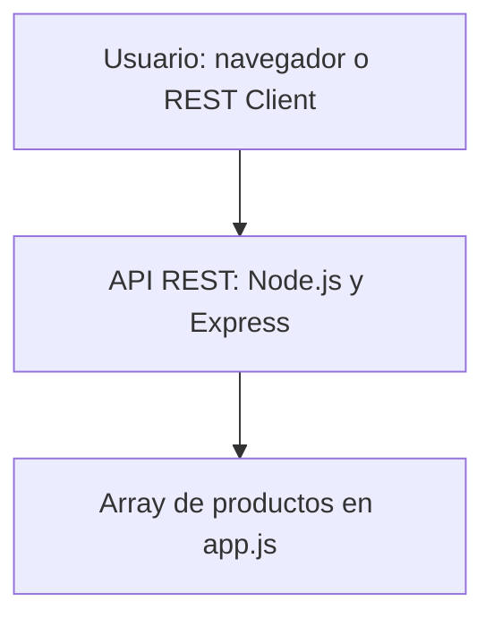

## Arquitectura

La aplicación está desarrollada on Node.js y Express. El archivo app.js contiene la configuración del servidor, los endpoints y los datos de los productos.

Actualmente, los productos están almacenados en un array dentro del propio código. La API permite consultar todos los productos o buscar uno concreto mediante su identificador.

## Diagrama de arquitectura

## Posible mejora de la arquitectura

Si los productos se almacenaran en una base de datos, la aplicación tendría que conectarse a ella para consultar los productos. 
Los datos dejarían de estar guardados directamente en el código y sería más fácil mantenerlos y actualizarlos sin modificar el archivo app.js

La arquitectura actual permite consultar losproductos mediante los endpoints de la API.